# 좌석 지정 영화 예매 시스템

[](https://github.com/rlagnlfo1004/movie-ticketing-system/actions/workflows/test.yml?query=branch%3Afeat%2Fseat-redesign)

한 상영의 1,000석을 여러 사용자가 동시에 고를 때 중복 예매를 막는 시스템이다. 대기열 입장 후 좌석을 선점하고, 결제 상태를 확인해 예매를 확정한다. 현재 구현 단계는 **V6: Redis AOF와 MySQL·PG 대사**까지 처리한다. 남은 정식 측정과 V7 결정은 [작업 지도](https://github.com/rlagnlfo1004/movie-ticketing-system/issues/2)에서 진행한다.

## 현재 흐름

1. `waiting-api`가 Redis 대기열 등록·순번 조회·입장을 처리한다.
2. `reservation-api`의 선점 Lua가 Redis active 키를 확인한다. waiting-api가 중단돼도 이미 입장한 토큰은 선점을 이어갈 수 있다.
3. 사용자가 1~4석을 같은 Lua 실행에서 선점한다. 한 좌석이라도 사용할 수 없으면 전체 요청이 실패한다.
4. 서버가 결제를 모의 PG에 사전 등록한다. 승인 뒤에는 서명된 웹훅과 클라이언트 완료 호출 중 먼저 도착한 경로가 PG 상태·금액을 조회해 Redis에서 예매를 확정한다.
5. 확정 이벤트는 Redis Stream에 같은 Lua 실행 안에서 기록된다. 별도 `reservation-worker`가 최대 100건씩 MySQL에 적재하고 커밋한 뒤 ACK한다. worker가 죽어도 PEL의 미확인 항목을 회수한다.
6. Redis AOF는 `appendfsync everysec`으로 기록한다. Redis가 재시작되면 예매 API가 MySQL 확정 좌석을 복원하고 PG 승인 내역을 대사한 뒤에 선점을 받는다.

V1은 MySQL 좌석 잠금에서 deadlock이 났고, V2는 잠금 순서를 고쳐 상영 행 직렬화가 남았다. V3는 좌석 상태를 Redis로 옮겼지만 Pub/Sub 이벤트가 worker 재기동 뒤 유실됐다. V4는 Streams의 PEL·ACK·XAUTOCLAIM으로 그 누락을 회수했다. V5는 waiting-api HTTP 확인을 선점 Lua의 active 키 검사로 옮겼다. V6는 AOF와 결제 대사로 Redis 재시작 때의 남은 차이를 다룬다. 단계별 원본은 [`docs/evidence/`](docs/evidence/)에 있다. 측정 전제와 가정은 [`infra/tuning/README.md`](infra/tuning/README.md)와 [`load-test/README.md`](load-test/README.md)에 적었다.

## 서비스 화면 데모

[`/demo/`](http://localhost:8000/demo/)에서 대기열 입장부터 좌석 선택·선점·결제·예매 완료까지 체험할 수 있다. 기본 화면과 운영 현황은 **목 데이터로 만든 시연용**이며 측정 근거로 사용하지 않는다. Docker Compose를 실행하지 않아도 `reservation-api/src/main/resources/static/demo/index.html`을 브라우저에서 열어 볼 수 있다.

| 순서 | 데스크톱 1440px | 모바일 390px |
| --- | --- | --- |
| 대기열 | 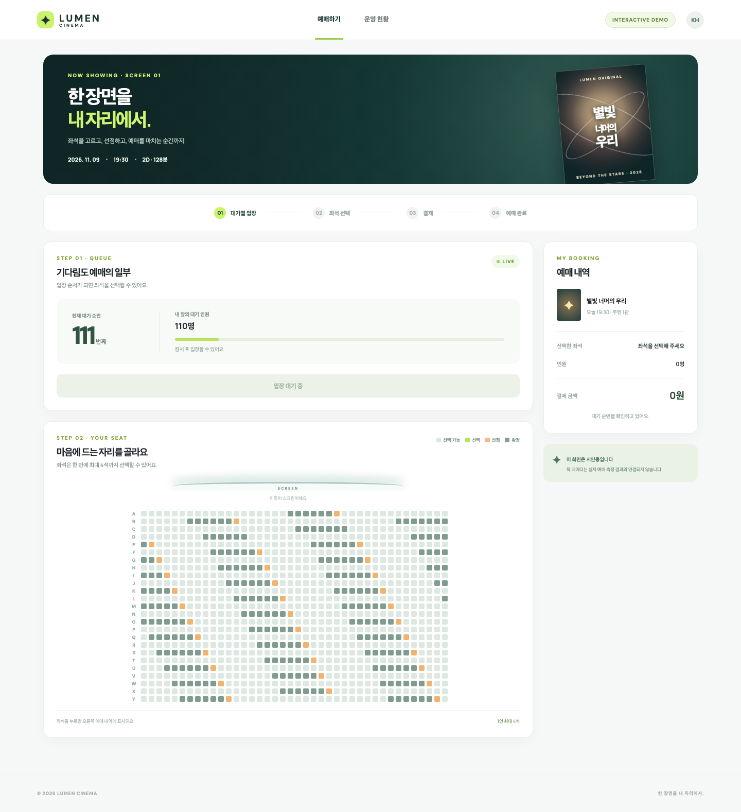 | 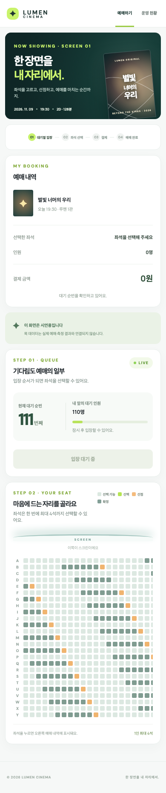 |
| 좌석 선택 | 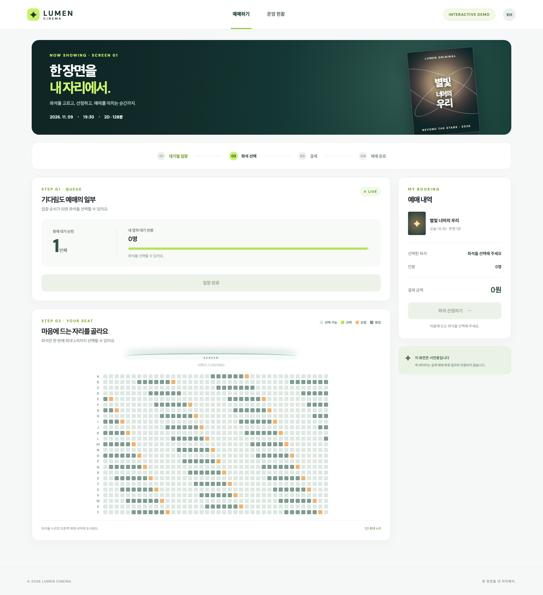 | 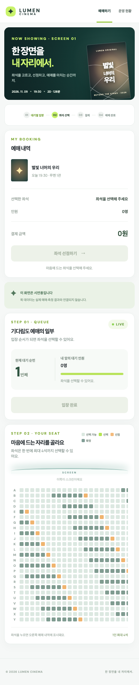 |
| 선점과 타이머 | 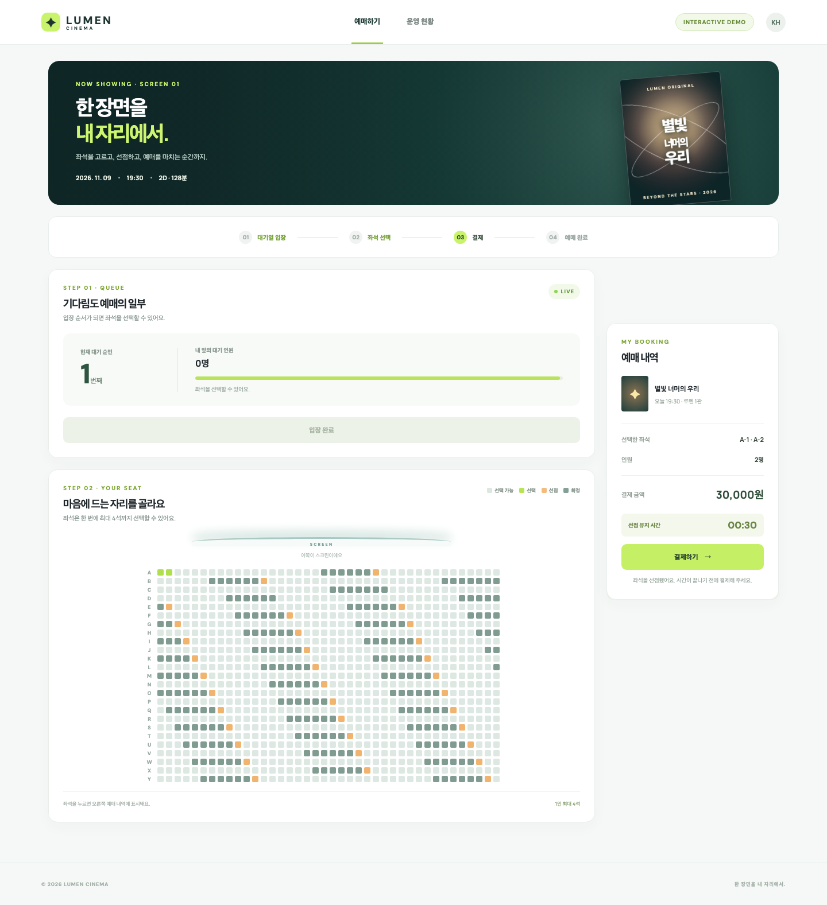 | 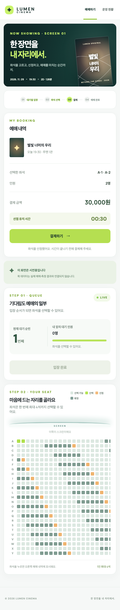 |
| 예매 확정 | 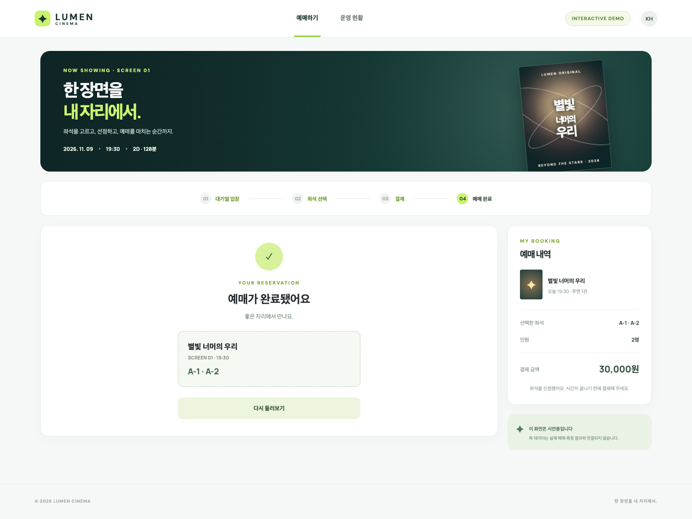 | 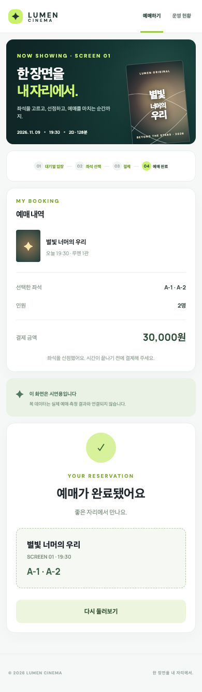 |
| 선점 만료 |  | 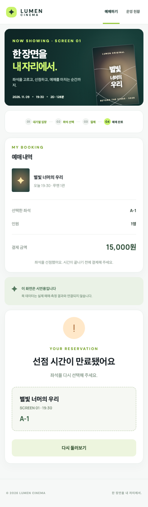 |
| 좌석 충돌 | 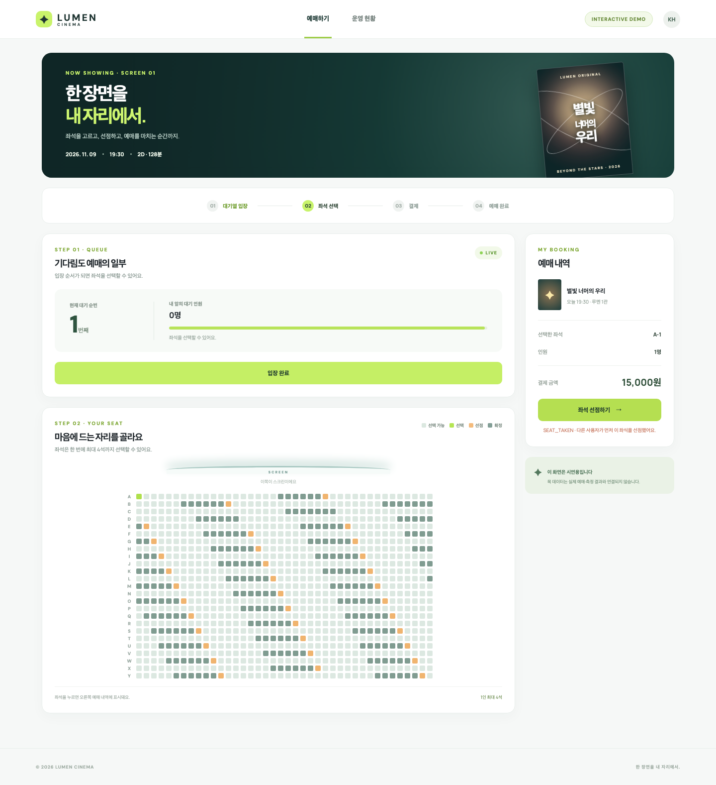 | 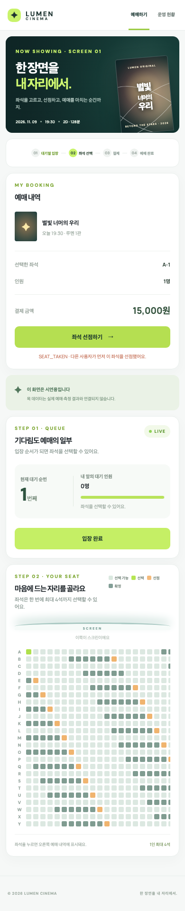 |
| 운영 현황 | 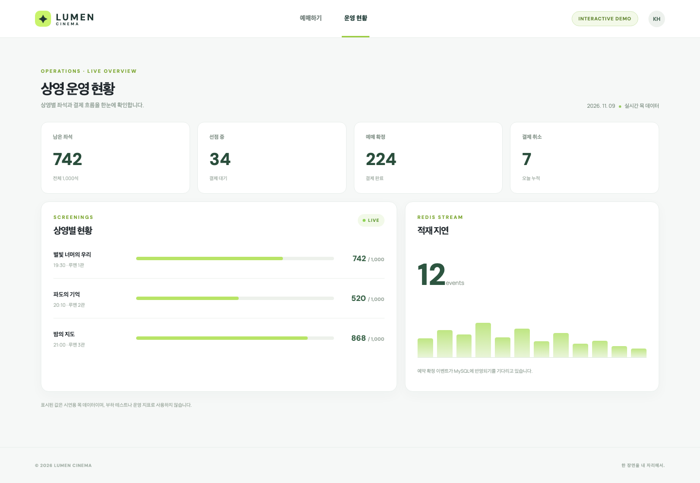 | 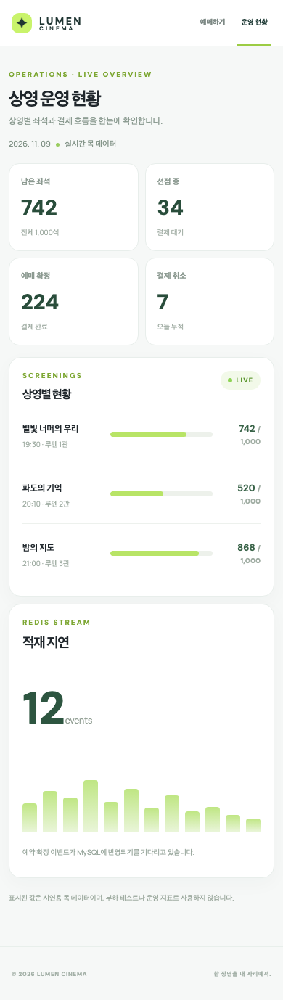 |

캡처를 다시 만들려면 다음 명령을 실행한다. 기본값은 로컬 HTML의 목 데이터이며, `DEMO_URL=http://localhost:8000/demo/ npm run capture`로 Docker Compose의 페이지를 캡처할 수도 있다. 두 브라우저 컨텍스트가 같은 좌석을 선점하는 장면도 스크립트가 재현한다.

```bash
cd load-test/demo-capture
npm ci
npx playwright install chromium
npm run capture
```

PortOne 실결제 확인은 서버를 실제 PortOne API로 설정한 뒤 `python3 load-test/demo-capture/open-live.py`로 연다. 이 스크립트는 로컬 `~/.config/movie-ticketing/portone.env`에서 공개 `PORTONE_STORE_ID`와 `PORTONE_CHANNEL_KEY`만 읽어 `mode=live` 화면을 연다. `--base-url`로 ngrok 등의 공개 주소를 지정할 수 있다. API 시크릿과 웹훅 시크릿은 브라우저에 전달하지 않는다. 이 경로의 실제 결제창 캡처는 [PortOne 검증 작업](https://github.com/rlagnlfo1004/movie-ticketing-system/issues/22)에서 진행한다.

## 로컬 실행

Java 21과 Docker Compose가 필요하다.

```bash
python3 infra/stages/ensure-local-env.py
./gradlew :waiting-api:bootJar :reservation-api:bootJar :reservation-worker:bootJar
docker compose up -d --build
bash load-test/v3-smoke.sh
python3 load-test/v3-atomic-smoke.py
python3 load-test/v3-late-payment-smoke.py
python3 load-test/v4-idempotency-smoke.py
bash load-test/v5-waiting-outage-smoke.sh
python3 load-test/v6-reconcile-smoke.py
python3 load-test/v6-stream-fallback-smoke.py
```

API는 `http://localhost:8000/api/v1`에서 받는다. 첫 기동에서 상영 `1`의 25행×40열 좌석을 만든다. 모의 PG는 `http://localhost:8082`, Grafana는 `http://localhost:3000`이다.

| 메서드 | 경로 | 동작 |
| --- | --- | --- |
| POST | `/screenings/{sid}/queue/register` | 대기열 토큰 발급 |
| GET | `/screenings/{sid}/queue/status?token=...` | 입장 상태 조회 |
| GET | `/screenings/{sid}/seats` | 좌석 상태 조회 |
| POST | `/screenings/{sid}/holds` | 좌석 선점, `Queue-Token`·`Idempotency-Key` 필수 |
| POST | `/payments/{paymentId}/complete` | PG 조회 후 예매 확정 |
| POST | `/webhooks/portone` | 서명 검증 후 결제 웹훅으로 예매 확정 |
| GET | `/screenings/{sid}/reservations/me` | 내 선점·확정 상태 조회 |

선점 본문은 `{"seats":["A-12","A-13"]}`이고, 응답은 `holdId`, `paymentId`, `amount`, `heldUntil`, `customData`를 담는다. 좌석 가격은 한 석에 15,000원이다. 앱은 `customData`를 그대로 PortOne `requestPayment`에 전달한다. 필드 의미와 처리 방법은 [`docs/api/payment-context.md`](docs/api/payment-context.md)에 있다.

Redis 재시작 시 예매 API의 readiness가 UP이 되기 전에 대사가 끝난다. 직접 다시 대사할 때는 로컬 `POST http://localhost:8081/admin/reconcile`을 호출하고, `GET`으로 마지막 확정·취소 목록을 확인한다.

로컬 비밀 값은 저장소에서 제외한 `.env`에 생성한다. 단계별 설정과 가상 스레드 비교 방법은 [`infra/stages/README.md`](infra/stages/README.md)에 있다.

## 검증

```bash
./gradlew test
SMOKE=1 SCENARIO=A STAGE=v6-aof-reconcile ./load-test/run.sh
```

로컬 스모크는 기능과 캡처 경로만 확인한다. 정식 처리량·지연 수치는 모든 단계를 같은 AWS 환경에서 실행하는 측정일에 기록한다. 용어는 [`GLOSSARY.md`](GLOSSARY.md), 설계 배경은 [`docs/adr/`](docs/adr/)에 있다.
