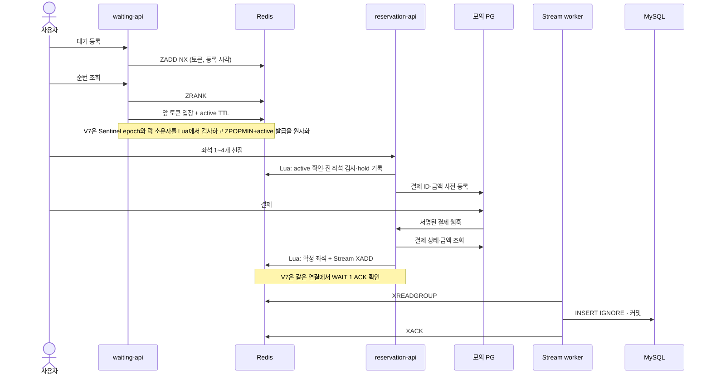
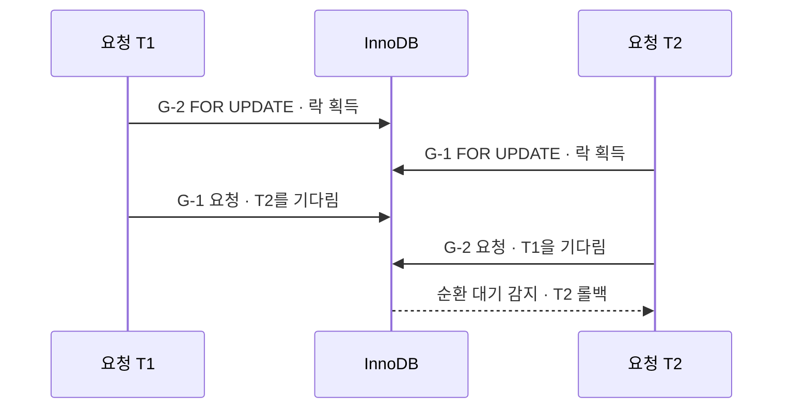
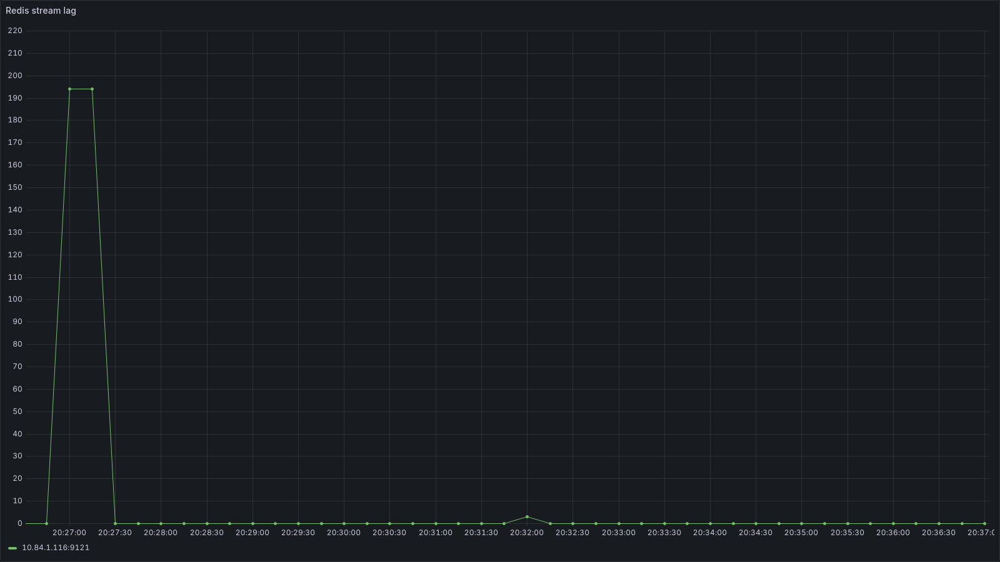
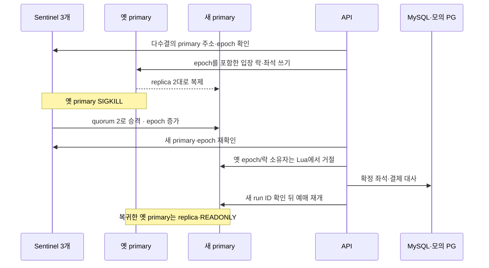

# 좌석 예매 재구성 V0~V7: 구현과 측정 결과

2026-11-10 기준. [작업 지도 #2](https://github.com/rlagnlfo1004/movie-ticketing-system/issues/2) · [Figma 면접 준비](https://www.figma.com/design/rUd2thJ5MDkYUzjrywde57/?node-id=1288-2)

## 먼저 읽을 결론

이 보고서에서 **V0**라고 부르는 것은 단계 태그가 없는 기존 수량 발급 모델이다. 상영의 수량 1,000장을 Redis에서 차감했다. V1부터 사용자가 고른 특정 좌석을 선점하고 결제 뒤 확정하는 모델로 바꿨다. 따라서 V0의 요청 처리 수치와 V1~V7 좌석 선점 수치는 시험 대상부터 달라 직접 비교하지 않는다. [기존 README](https://github.com/rlagnlfo1004/movie-ticketing-system/blob/9e99265/README.md) · [모델 변경 결정](../adr/0001-seat-based-reservation.md)

같은 AWS 서울 환경에서 정식 측정한 범위는 **V1~V6**다. DB 좌석 잠금 방식의 B 성공 선점은 V1 8.09 TPS, V2 8.04 TPS였고, Redis 선점 방식은 V3~V6에서 19.24~19.48 TPS였다. 전체 선점 요청 p95도 V1·V2는 약 3.5초, V3~V6은 2.72~5.02ms였다. B 후반에는 1,000석 소진 뒤 충돌 응답이 섞이므로 이 p95를 **성공한 선점만의 지연**으로 해석하지 않는다. 원본: [측정 방법과 실행별 결과](../../load-test/results/README.md).

**V7은 구현과 로컬 장애 검증까지만 완료했다.** Redis 3노드·Sentinel 3개에서 primary 강제 종료 뒤 4.626초에 승격했고, 최종 Redis 7석=MySQL 7석, 이전 primary 쓰기는 `READONLY`였다. 한 Docker 호스트의 검증이라 AWS 호스트 장애 수치가 아니다. V7 AWS 정식 측정은 [#27](https://github.com/rlagnlfo1004/movie-ticketing-system/issues/27)에 **미완·추후 진행**으로 남겼다. [로컬 원본](../evidence/v7-sentinel-fencing/local-smoke-20261110.md)

PortOne 실제 결제창 승인과 실제 웹훅 지연도 **미측정**이다. 모의 PG의 승인 500~2,000ms·웹훅 200~800ms·첫 발송 실패 1%는 가정값이다. 실제 V2 API 인증 조회와 결제 사전 등록 200까지 확인했으며, 실채널 검증은 [#22](https://github.com/rlagnlfo1004/movie-ticketing-system/issues/22)에 열어 두었다.

## V0에서 V7까지 무엇이 바뀌었나

```mermaid
flowchart LR
    V0["V0 수량 발급<br/>Redis 재고 숫자 차감"] --> V1["V1 좌석 지정<br/>MySQL FOR UPDATE"]
    V1 -->|deadlock·행 락 대기| V2["V2 잠금 순서 고정<br/>웹훅 멱등 확정"]
    V2 -->|상영 hot row 직렬화| V3["V3 Redis Lua 선점<br/>Pub/Sub 적재"]
    V3 -->|worker 중단 중 메시지 유실| V4["V4 Stream·PEL·ACK<br/>멱등 worker"]
    V4 -->|waiting-api HTTP 의존| V5["V5 active 검사도<br/>선점 Lua 안으로"]
    V5 -->|Redis 재시작 시 휘발 위험| V6["V6 AOF everysec<br/>MySQL·PG 대사"]
    V6 -->|단일 Redis 호스트 장애| V7["V7 Sentinel 승격<br/>epoch fencing·WAIT 1"]
```

| 단계 | 상태 저장과 핵심 변경 | B 성공 선점 TPS | B 전체 선점 p95 | 신규 deadlock(B) | 측정 상태 |
| --- | --- | ---: | ---: | ---: | --- |
| V0 | Redis 수량 차감·MySQL 발급 기록 | 비교 불가 | 비교 불가 | 비교 불가 | 좌석 모델 정식 측정 없음 |
| [V1](../../load-test/results/v1-db/) | MySQL 좌석 행 잠금 | 8.09 | 3,533.17ms | 172 | AWS 정식 |
| [V2](../../load-test/results/v2-db-fixed/) | 좌석 정렬·상영 행 선행 잠금·멱등 웹훅 | 8.04 | 3,471.49ms | 46 | AWS 정식 |
| [V3](../../load-test/results/v3-pubsub/) | Redis Lua 선점·Pub/Sub | 19.24 | 4.53ms | 0 | AWS 정식 |
| [V4](../../load-test/results/v4-streams/) | Redis Stream·커밋 뒤 ACK·XAUTOCLAIM | 19.48 | 5.02ms | 0 | AWS 정식 |
| [V5](../../load-test/results/v5-lua-active/) | active 키 검사를 선점 Lua로 이동 | 19.28 | 2.72ms | 0 | AWS 정식 |
| [V6](../../load-test/results/v6-aof-reconcile/) | AOF everysec·시작 시 대사 | 19.40 | 3.73ms | 0 | AWS 정식 |
| [V7](../evidence/v7-sentinel-fencing/local-smoke-20261110.md) | Sentinel·replica 2대·epoch fencing·WAIT 1 | — | — | — | 로컬 기능 검증만 |

표의 B는 active 토큰을 미리 발급하고 100→200→400→800→1,600→3,200 요청/초를 각 60초 보내는 시험이다. A는 상영 1개·1,000석·3만 명 등록/10초의 전체 흐름이며 V1·V2·V4·V6에서 각각 3회 수행했다. 서버는 AWS 서울 단일 AZ의 7호스트·26 vCPU였다. PG 지연은 모두 모의 가정이다. [환경·튜닝·시나리오 원본](../../load-test/results/README.md)

## 데이터가 지나가는 순서

V5~V7의 정상 경로를 그렸다. V1·V2 좌석 선점은 MySQL 트랜잭션, V3 Pub/Sub은 로그 비보존이므로 아래의 Stream 경로와 다르다.

대기열 ZSET의 score는 등록 시각이고 member는 토큰이다. `ZADD NX`는 재등록해도 기존 점수를 보존한다. `ZRANK`는 순번, `ZPOPMIN`은 앞쪽 입장이다. V1~V6은 pop과 active 생성이 별도 명령이라 사이 장애의 입장 누락 가능성이 남았다. V7은 이 구간을 락·세대 검사와 함께 Lua 하나로 묶었다. [대기열 코드](../../waiting-api/src/main/java/com/movie/waiting/repository/RedisQueueRepository.java) · [V7 Lua](../../waiting-api/src/main/resources/lua/admit-v7.lua)

## 실험으로 확인한 실패와 회복

### V1 → V2: 락 순서와 남은 hot row

V1 실제 InnoDB 기록에서 T1은 G-2를 보유한 채 G-1을 기다렸고, T2는 G-1을 보유한 채 G-2를 기다렸다. 겹치는 좌석이 있다는 사실만으로 deadlock이 되는 것은 아니다. **서로 보유한 행을 반대 순서로 기다리는 고리**가 생겨야 한다.

V2는 좌석 번호를 정렬하고 상영 행을 먼저 잠갔다. A 3회의 신규 deadlock은 V1 **85·439·304건 → V2 18·18·25건**으로 줄었지만 0은 아니었다. B 성공 선점도 8.09→8.04 TPS로 상한이 거의 같았다. DB 단독 hot row 실험은 연결 8개에서 최대 259 TPS였으나 연결 32·128개에서는 처리량이 약 256 TPS로 포화하고 p99가 134.79→519.80ms로 늘었다. DB 단독과 앱 전체 B는 시험 조건이 달라 두 TPS를 직접 나눠 병목 비율로 쓰지 않는다. [deadlock 원본](../evidence/v1-db/deadlock-row.json) · [DB 단독 원본](../../load-test/results/db-baseline/20261109T134320Z/README.md)

### V3 → V4: Pub/Sub 유실과 Stream 회수

같은 방식으로 worker를 시작 5초 뒤 강제 종료하고 약 30초 멈췄다. V3 Pub/Sub은 최종 Redis 확정 **782석**, MySQL 적재 **198석**으로 **584석 누락**, PG 승인 뒤 로컬 예약이 없는 건 **294건**이 남았다. 구독자가 없던 동안 발행된 메시지를 다시 읽을 위치가 없기 때문이다. [V3 장애 원본](../../load-test/results/v3-pubsub/20261109T174849Z-worker-kill-retry-204103/README.md)

V4 Stream에서는 중단 중 Redis **382석**·MySQL **0석**·lag **194건**이었지만, worker 재시작 뒤 **382=382석**, lag **0건**이 됐고 최종 **686=686석**이었다. `XREADGROUP` 뒤 DB 커밋 전에 죽은 메시지는 PEL에 남고 `XAUTOCLAIM`으로 회수한다. 커밋 뒤 ACK 전에 죽으면 중복 전달될 수 있으므로 MySQL UNIQUE 제약과 `INSERT IGNORE`로 멱등 처리한다. [V4 장애 원본](../../load-test/results/v4-streams/20261109T181840Z-worker-kill-retry-202308/README.md) · [중단 시 스냅샷](../evidence/v4-streams/20261109T181840Z-worker-kill-retry-202308-stream-during-outage.json) · [회복 시 스냅샷](../evidence/v4-streams/20261109T181840Z-worker-kill-retry-202308-stream-after-recovery.json)

V4의 별도 MySQL 중단 실험에서는 Stream lag 최대 **238건**, 복구 뒤 PG 승인 **239/239건**이 DB에 확정됐다. 중단 창 웹훅 p95 최대 **0.02초**였다. [MySQL 중단 원본](../../load-test/results/v4-streams/20261109T181840Z-mysql-stop/README.md)

### V5 → V6: 의존성 제거와 영속성

V5는 reservation-api가 waiting-api에 active 여부를 HTTP로 묻던 구간을 선점 Lua 안으로 옮겼다. waiting-api 전체 중단 중에도 기존 active 토큰의 선점이 **411/3,995회** 성공했다. 이 비율의 분모에는 좌석 충돌 실패도 들어 있어 API 가용률로 해석하면 안 된다. [V5 장애 원본](../../load-test/results/v5-lua-active/20261109T205834Z-waiting-stop/README.md)

V6은 Redis AOF `everysec`과 MySQL·모의 PG 대사를 붙였다. B 전체 선점 p95/p99는 `everysec` **3.73/6.26ms**, `always` **14.98/18.08ms**였다. Redis SIGKILL/AOF 재기동 뒤 최종 Redis **693석=MySQL 693석**, PG 승인 **365건=확정 365건**이었다. 이 실행에서 대사가 실제 손실을 복원한 건수는 **0건**이다. 따라서 “손실 복구를 실증했다”가 아니라 “이번 장애에서 일관성이 유지됐다”고 기록한다. [AOF 비교와 장애 원본](../../load-test/results/README.md) · [V6 최종 스냅샷](../evidence/v6-aof-reconcile/20261109T212410Z-redis-kill-retry-225513-final-balance.json)

### V7: 호스트 승격은 로컬까지

로컬 Docker에서 primary 종료 뒤 승격 **4.626초**, epoch **6→7**, 승격 전후 각각 결제 확정, 최종 Redis **7석=MySQL 7석**을 확인했다. `WAIT 1`은 replica의 수신 ACK이고 fsync나 강한 일관성 보장은 아니다. 같은 Docker 호스트의 결과로 AWS 호스트 장애와 네트워크 분할을 입증할 수 없다. [V7 로컬 근거](../evidence/v7-sentinel-fencing/local-smoke-20261110.md) · [Redis Sentinel 공식 설명](https://redis.io/docs/latest/operate/oss_and_stack/management/sentinel/)

## 아직 하지 않은 일

| 작업 | 현재 상태 | 추후 재개 위치 |
| --- | --- | --- |
| V7 AWS B·primary 장애 정식 측정 | 미실행. V7 p95·TPS·승격 시간의 AWS 값 없음 | [#27](https://github.com/rlagnlfo1004/movie-ticketing-system/issues/27), [AWS 실행·즉시 삭제 런북](../../infra/aws/v7-measure-and-destroy.sh) |
| PortOne 실제 결제·웹훅 지연 | 미실행. API 조회·사전 등록만 확인 | [#22](https://github.com/rlagnlfo1004/movie-ticketing-system/issues/22), [로컬 검증 런북](../agents/portone-live-runbook.md) |

V6 유료 측정 인프라는 Terraform destroy 뒤 EC2·EBS·VPC 등 원생 API에서 잔존 **0개**였고 측정용 IAM 키도 삭제했다. V7은 아직 AWS `apply`를 한 적이 없다. [AWS 정리 근거](../evidence/aws-cleanup-20261110.md)

## 다른 컴퓨터에서 보는 순서

1. 이 리포트로 단계별 결론과 **정식/로컬/미측정** 경계를 확인한다.
2. [Figma 면접 준비 프레임](https://www.figma.com/design/rUd2thJ5MDkYUzjrywde57/?node-id=1288-2)에서 좌석 흐름·deadlock·Stream 복구·AOF·V7 도식을 본다. 같은 Figma 페이지 오른쪽에는 Grafana 원본 1,050장과 상태 JSON 카드 213개가 있다.
3. [측정 결과 인덱스](../../load-test/results/README.md)에서 V1~V6의 실행별 `summary.json`, Grafana PNG, Prometheus JSON을 연다. V7 AWS 원본은 아직 없다.
4. [상태 원본](../evidence/)에서 시각별 Redis·MySQL·결제 균형과 쿼리 원문을 확인한다.

Git의 추적 파일과 Figma는 다른 컴퓨터에서도 해당 저장소·Figma 파일 접근 권한만 있으면 읽을 수 있다. `.local/` 원본과 AWS·PortOne·ngrok 비밀 값은 Git에 없으므로 추후 측정을 다시 시작하는 컴퓨터에 별도로 설정한다. [작업 지도](https://github.com/rlagnlfo1004/movie-ticketing-system/issues/2)에 열린 #27·#22가 다음 작업을 가리킨다.
